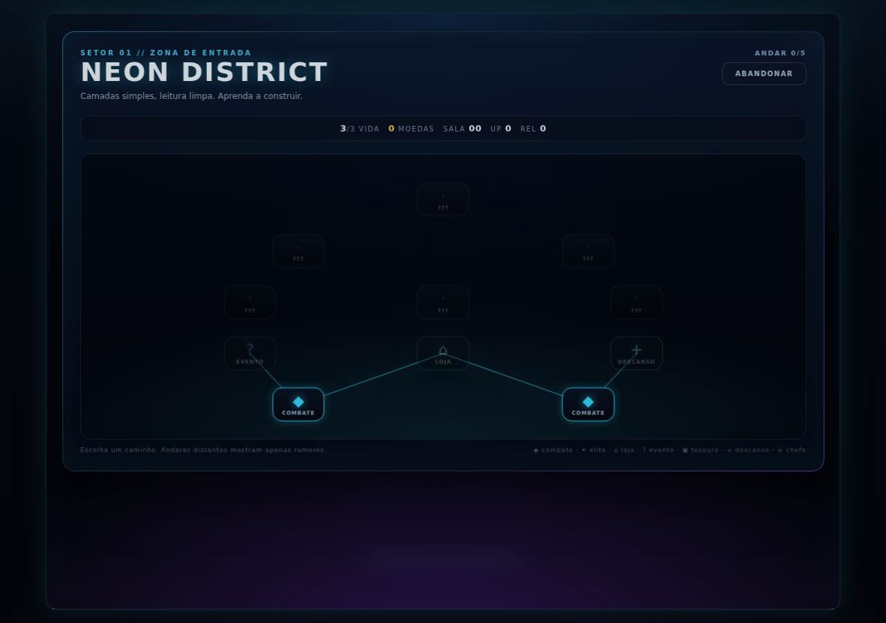
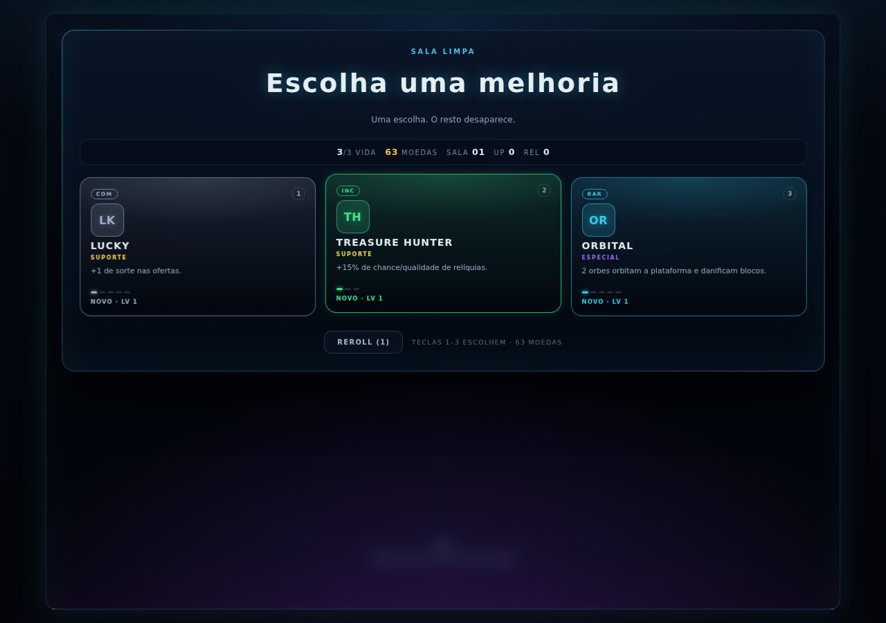
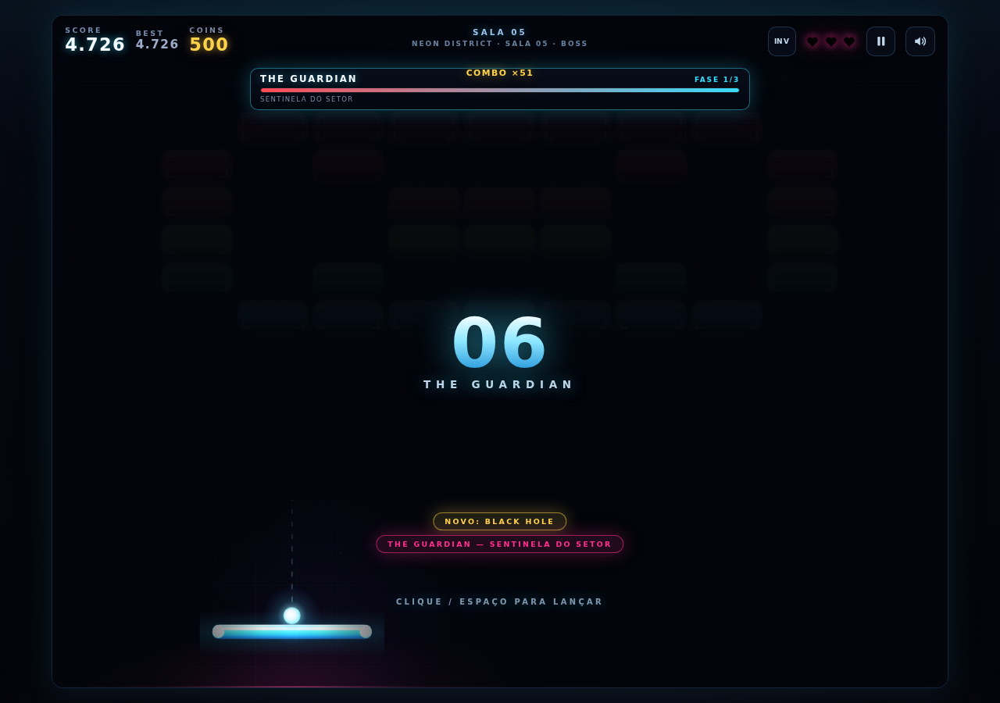

# NEON BREAKER — ROGUELITE ARCADE

Breakout arcade em JavaScript puro (ES Modules) + Canvas 2D + Web Audio API, evoluído para um **roguelite completo**: runs com mapa ramificado, upgrades com raridades e evolução, relíquias, sinergias, loja, eventos, modificadores de sala, chefes e progressão permanente. Sem frameworks, sem dependências de runtime e sem assets externos — gráficos, áudio e física são gerados em tempo de execução.



<p align="center">
  
  
</p>

---

## Como rodar

Requer **Node.js 18+** (apenas para servir arquivos estáticos — o jogo é 100% front-end).

```bash
npm start          # http://localhost:4173
# ou
python3 -m http.server 4173
```

> Abrir `index.html` direto via `file://` não funciona porque ES Modules exigem HTTP.

---

## Modos de jogo

| Botão | Modo |
| --- | --- |
| **JOGAR RUN** | Roguelite principal: mapa, salas, recompensas, chefes e meta progressão. |
| **CONTINUAR RUN** | Retoma a última run salva em uma fronteira de mapa (aparece quando existe save ativo). |
| **ARCADE CLÁSSICO** | Campanha original de 12 fases, preservada para quem quer o Breakout puro. |
| **PROGRESSÃO** | Árvore de DATA, plataformas, setores, bibliotecas, bônus e skins. |

---

## Controles

| Ação | Teclado / Mouse | Touch |
| --- | --- | --- |
| Mover a plataforma | mouse, `←` `→`, `A` `D` | arrastar / tocar |
| Lançar a bola / soltar ímã | `Espaço`, `Enter`, `↑` ou clique | toque |
| Pausar / continuar | `P`, `Esc` | botão ⏸ no HUD |
| Som on/off | `M` | botão 🔊 no HUD |
| Inventário | `I` ou `Tab` | botão **INV** no HUD |
| Escolher carta / evento | `1` `2` `3` | clique |
| Confirmar consequência | `Enter` / `Espaço` | botão CONTINUAR |

---

## Estrutura da run

- **4 setores × 5 andares = até 20 salas por run** (as primeiras runs usam os setores 1–2; os setores 3–4 são desbloqueados com DATA).
- Setores: **NEON DISTRICT** (introdução), **CYBER FACTORY** (blocos resistentes), **VOID DIMENSION** (modificadores e layouts complexos) e **CORE SYSTEM** (dificuldade máxima).
- Setores 3 e 4, parte das relíquias/upgrades e plataformas alternativas são desbloqueados com DATA.
- O mapa é procedural (seed por run), com 2–3 caminhos por andar, loja/evento garantidos por setor e chefe no último andar.
- Andares distantes aparecem como rumores (`???`); só o próximo andar revela os tipos de sala.
- Chefes: **THE GUARDIAN**, **THE DESTROYER**, **THE CORE** e a forma final **CORE // FINAL FORM**, cada um com fases, projéteis, barreiras e mecânicas próprias.

```
MENU → MAPA → BRIEFING (modificadores) → SALA → RECOMPENSA (3 cartas) → MAPA
                 └── LOJA / EVENTO / DESCANSO / TESOURO ──┘
CHEFE DO SETOR → PRÓXIMO SETOR → RUN SUMMARY (DATA + código)
```

---

## Sistemas roguelite

### Upgrades e raridades
- **29 upgrades** em 4 categorias: ofensivo, defensivo, suporte e especial.
- Raridades: Comum 55%, Incomum 25%, Raro 13%, Épico 6%, Lendário 1% (configurável em `RogueliteConfig.js`).
- Sorte desloca peso para tiers altos; há **pity** após 5 ofertas sem Raro+.
- Repetir um upgrade **evolui o nível** (até 5; alguns até 3) e altera o efeito real. Nível máximo sai do pool.
- Efeitos conectados ao motor: fogo/queimadura, arcos elétricos, explosões, corrente, pierce, crítico, multiball, lasers, órbitas, black hole, clone de plataforma, vortex/gravidade, câmbio de bola e muito mais.

### Relíquias
Efeitos permanentes de regra (não só stats): vida extra, moedas, relógio quebrado, caos, Phoenix (revive 1×), dados do apostador, canhão de vidro, ímã de moedas, escudo por sala, slow passivo, desconto na loja e reroll extra. Limite padrão de **3 relíquias** por run.

### Sinergias
Combinações detectadas automaticamente, com banner e registro no código:
`OVERLOAD`, `SUPERNOVA`, `GOLDEN CIRCUIT`, `AEGIS PROTOCOL`, `SWARM`, `GLASS STORM`, `VOID PACT` e `BULLET TIME`.

### Loja e economia
- Estoque com upgrades, relíquia, cura e reroll pago (preço cresce a cada uso).
- Preços por raridade e setor, com descontos de build/relíquia.
- Moedas vêm de blocos, bônus de sala, elite, chefe e eventos; coleta automática ao limpar a sala.

### Eventos
7 eventos com escolhas e consequências reais: contrato de vida, tesouro instável, sacrifício de upgrade, anomalia de modificadores, mercador misterioso, fragmento de DATA e santuário glitch.

### Modificadores de sala
Anunciados no briefing: escuridão, bola rápida, double trouble, baixa gravidade, caos, armadura, espelho e inflação (blocos ganham resistência com o tempo).

### Meta progressão
- DATA ao fim da run = salas + chefes + score + moedas + sinergias, com multiplicador de build e bônus de vitória.
- Árvore com plataformas (Standard/Speedster/Defender/Engineer/Gambler), setores 3/4, packs de relíquias/upgrades experimentais, +1 vida inicial, +20 moedas, +1 reroll e skins.
- Persistência versionada (`neonBreaker.save.v2`) com migração dos dados antigos e validação contra saves corrompidos.

---

## Arquitetura

```
src/
  core/        Config, GameEngine, MathUtils
  physics/     CollisionSystem, PhysicsEngine (passo fixo 120 Hz, inalterado)
  levels/      Levels (12 clássicas), LevelManager, RoomLayouts (8 extras + arenas de chefe)
  entities/    Ball, Paddle, Block, PowerUp, PaddleClone
  render/      GameRenderer, SpriteFactory
  systems/     ParticleSystem, PowerUpManager, AudioManager, StorageService
  input/       InputController
  ui/          GameUI (HUD/telas clássicas), RogueliteUI (mapa, cartas, loja, meta…)
  roguelite/
    RogueliteManager  RunManager  MapManager  RoomFactory
    UpgradeManager    UpgradeLibrary  BuildStats
    RelicManager      RelicLibrary    SynergyManager/Library
    RoomModifierManager/ModifierLibrary
    ShopManager  EventManager/EventLibrary  BossManager/BossLibrary
    EffectRuntime  CoinSystem
    MetaProgressionManager  SaveManager  Rng  RogueliteConfig
```

O `GameEngine` continua sendo a única fonte de verdade da simulação viva. O `RogueliteManager` controla fluxo e telas; os efeitos entram por eventos (`onBallHitBlock`, `onBlockDestroyed`, `onAllBallsLost`, etc.) e leem um objeto de stats compilado — adicionar um upgrade novo não exige alterar o motor.

A física original foi preservada. Os únicos ganchos novos são opcionais: gravidade de modificador, colisão com clones e checagem de pierce.

---

## Balanceamento central

Tudo em `src/roguelite/RogueliteConfig.js`: pesos de raridade, sorte/pity, preços, rerolls, cura, moedas, recompensas por sala, escalonamento por setor, caps de relíquias/upgrades, multiplicadores de DATA e custos da árvore meta. Limites de segurança impedem builds invencíveis (escudos máx. 4, pierce máx. 90%, second chance máx. 85%, profundidade de explosão/corrente ≤ 3).

---

## Testes

```bash
npm test            # 56 checks unitários/integração (node:test)
npm run test:e2e    # 83 checks em Chromium real (Playwright)
npm run capture     # screenshots em tests/e2e/screens/
```

- **Unitários/integração:** física original (12 fases), mapas (4 setores × 60 seeds), ofertas/raridade/pity, level-up, caps de build, sinergias, relíquias, economia, eventos, save/migração, fluxo completo de sala, efeitos no motor, reset entre salas, chefes, perda de run, retomada e loja.
- **E2E:** 34 checks de gameplay clássico, 19 de UI/preferências e **30 do roguelite** (mapa, briefing, inventário, recompensa, loja, evento, chefe, avanço de setor, resume após reload, meta persistente, mobile e zero erros de console).

### Resultado da última execução

```
56/56 unit checks passed
34/34 checks passed   (smoke)
19/19 flow checks passed
30/30 roguelite checks passed
```

---

## Compatibilidade

Chromium/Edge 111+, Firefox 113+, Safari 16.4+ (`color-mix`, `backdrop-filter`, `dvh`, `ResizeObserver`). O áudio é inicializado apenas após o primeiro gesto do usuário, conforme as políticas de autoplay.
